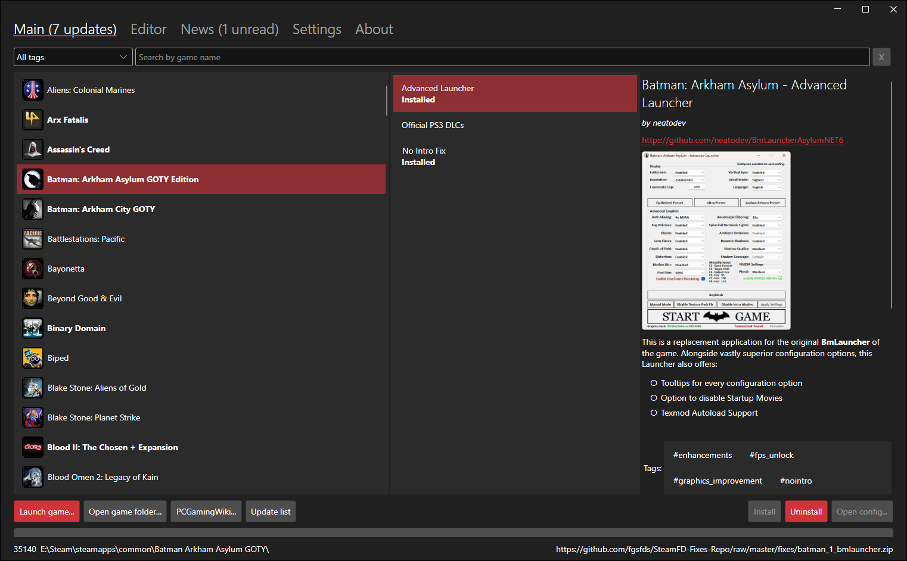
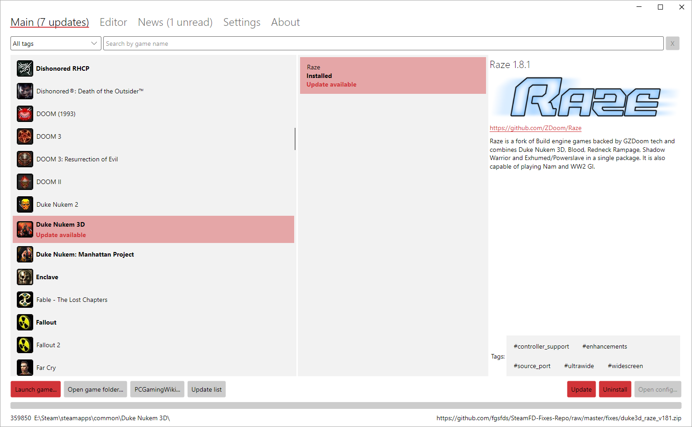
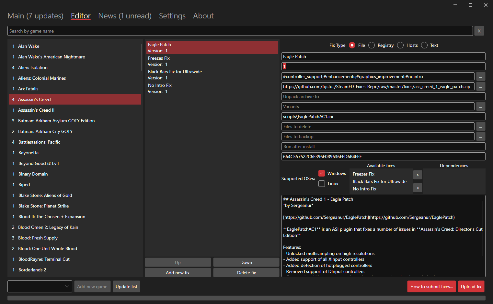

<table>

<tr>
<td align="center" valign="middle">

</td>
</tr>

<tr>
<td align="center" valign="middle">
<b>What is Superheater?</b>
</td>
</tr>

<tr>
<td valign="center">


<b>Steam Superheater</b> is an app whose main purpose is to simplify the process of installing various must-have fixes and patches for Steam games.

The ever-growing list of fixes includes, but is not limited to, (ultra)widescreen fixes, crash workarounds, unofficial patches, modern source ports for older games, and no intro fixes.

It's not meant to be an ultimate mod manager, but rather an easy way to fix and improve Steam games that are broken or have troubles running on modern systems out of the box.

</td>
</tr>

<tr>
<td align="center" valign="middle">
<b>How does it work?</b>
</td>
</tr>

<tr>
<td valign="center">


Superheater features different types of fixes. File fixes replace or delete files in the game folder. Registry fixes add or change registry values. And hosts fixes add entries to Windows' hosts file.

Installing fixes is done by pressing a single button: no third-party installers or fiddling around with files, folders or registry is necessary. Just press Install and then run the game normally from Steam.

Original files are backed up under <code>.superheater</code> in the game folder and used when uninstalling. Keep those backups while fixes are installed. Failed operations can leave partial changes; see the <a href="docs/usage.md">usage and recovery guide</a>.

<a href="db/fixes.md">Full list of available fixes can be seen here.</a>


</td>
</tr>

<tr>
<td align="center" valign="middle">
<b>Where do fixes come from?</b>
</td>
</tr>

<tr>
<td valign="center">


Fixes are hand-picked, verified, and prepared (if needed) by me. Some are downloaded directly from the fix developer's GitHub, some are repacked to support single-button install and put into my storage.

Superheater also includes fixes <b>editor</b> which allows users who want to help fixes database grow to add and submit their own fixes.

Submissions require maintainer review before inclusion in the public database. Upload availability depends on the configured service; the default GitHub backend does not support direct database changes. See the <a href="docs/development.md#contributing-catalog-entries">catalog contribution guide</a>.

</td>
</tr>

<tr>
<td align="center" valign="middle">
<b>Is it secure?</b>
</td>
</tr>

<tr>
<td valign="center">


Superheater is standalone and doesn't require Steam credentials or any other sensitive information to work.

Downloaded fix archives can be checked against the catalog's SHA-256 hash to detect changed content. A hash check is not a malware scan or a guarantee of safety. Verification can be explicitly bypassed; see the <a href="docs/usage.md#integrity-and-trust">integrity and trust notes</a> before installing an unexpected replacement.

</td>
</tr>

<tr>
<td align="center" valign="middle">
<b>How to use</b>
</td>
</tr>

<tr>
<td valign="center">

Download latest release for your platform from <a href="https://github.com/fgsfds/Steam-Superheater/releases">release page</a>

Unpack zip archive anywhere and run <b>Superheater.exe</b> or <b>Superheater</b> 

For **Steam Deck** see <a href="https://github.com/fgsfds/Steam-Superheater/wiki/Deck-install-guide">this guide</a>

</td>
</tr>

<tr>
<td align="center" valign="middle">
<b>Sponsors</b>
</td>
</tr>

<tr>
<td>

<div style="display: flex; align-items: center;">
	Free code signing provided by <a href="https://about.signpath.io/"><b>SignPath.io</b></a>, certificate by <a href="https://signpath.org/"><b>SignPath Foundation</b></a>
</div>

</td>
</tr>

<tr>
<td align="center" valign="middle">
<b>Links</b>
</td>
</tr>

<tr>
<td>

<div style="display: flex; align-items: center;">
	 <a href="https://discord.gg/mWvKyxR4et"><b>Discord</b> server</a>
</div>

</td>
</tr>

</table>

## Documentation

- [User guide](docs/usage.md): setup, backups, offline mode, data locations, and troubleshooting.
- [Development guide](docs/development.md): build, test, publish, architecture, and catalog contributions.
- [Review and improvement plan](docs/review-plan.md): prioritized defects, refactoring proposals, and validation criteria.
- [Coding-agent instructions](AGENTS.md): repository conventions and guardrails.

## Build from source

Use a .NET 10 SDK and run from the repository root:

```powershell
dotnet restore
dotnet build --no-restore
dotnet run --project src/Avalonia.Desktop -- --offline
```

On Linux, add `-c Debug-Linux` before `--`. Published releases are self-contained. See the development guide before running integration tests: some use real files, registry entries, or external services.
